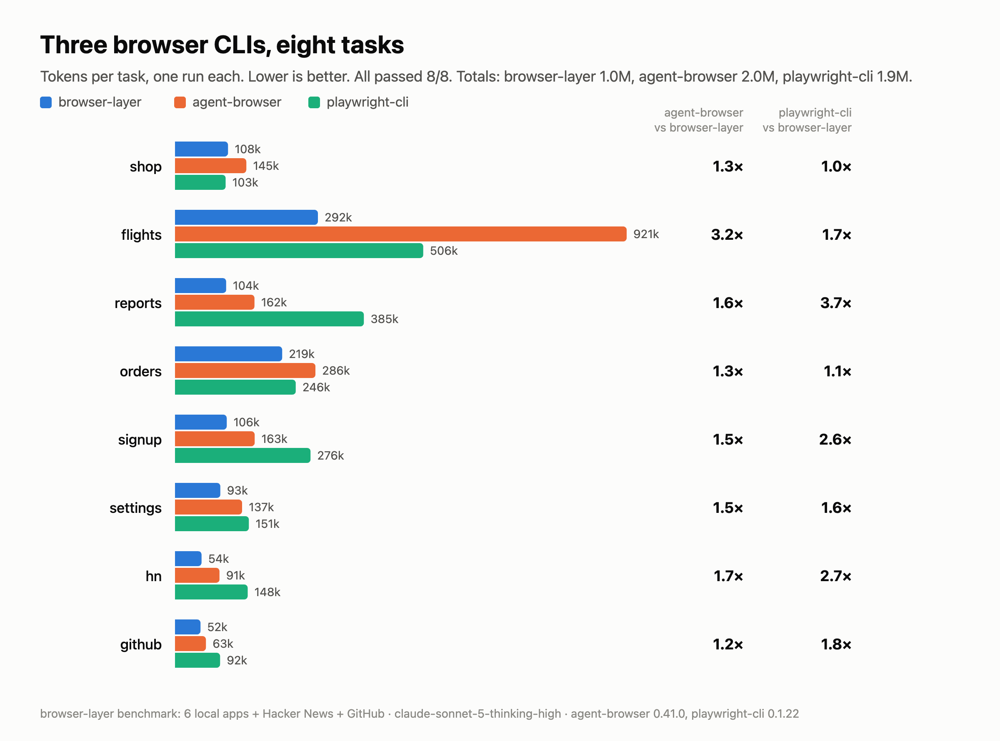

# browser-layer

A terminal browser for AI agents. A page comes back as a short text map of its regions and controls,
every action answers with what changed, and lists and tables come back as records. The agent reads
text: no screenshots, no DOM dumps.

## Benchmark

Eight end-to-end tasks (six web apps plus Hacker News and GitHub): the same agent, model, prompt
and task for each tool, with only the browser CLI changing. Every answer is checked against ground
truth.

| | browser-layer | agent-browser 0.41.0 | playwright-cli 0.1.22 |
|---|---|---|---|
| Tasks passed | 8/8 | 8/8 | 8/8 |
| Tokens | **1.03M** | 1.97M | 1.91M |
| Steps | **47** | 64 | 83 |
| Time | **3.2 min** | 5.8 min | 4.9 min |

browser-layer used about half the tokens of either and the fewest steps, and was the cheapest on
7 of 8 tasks.



Agent: cursor-agent with `claude-sonnet-5-thinking-high`, one run per tool per task. Tasks, runner,
raw data and method: [github.com/NAMANIND/browser-layer](https://github.com/NAMANIND/browser-layer/blob/main/bench/RESULTS.md).

### Against Browser Use 1.0 CLI

On 50 open-web tasks from BU Bench V2.1 that were never used while tuning, run by the same agent (Codex,
gpt-6-luna) and scored by the same judge, one run per task and tool, 5 tasks at a time:

| | browser-layer 0.1.4 | Browser Use 1.0 CLI |
|---|---|---|
| Mean score | 0.404 | 0.408 |
| Minutes per task | 6.4 | 5.5 |
| Steps per task | 44.3 | 41.0 |
| Cost per task at list price | $0.42 | $0.47 |
| Timeouts | 1 | 1 |

Paired by task, no metric differs beyond chance (95% intervals include zero): the two tools are level on score,
with browser-layer 11% cheaper and 16% slower in total, both inside the noise at 50 tasks. Many of these tasks
hit sites that block automated browsers, which lowers both scores.

## Install

Needs Node.js 22 or newer, on macOS, Linux or Windows.

```bash
npm install -g browser-layer
browser-layer browser        # which browser it will drive
```

browser-layer drives a browser you already have: Google Chrome, then Microsoft Edge, then Chromium,
whichever it finds first (every Windows machine has Edge). To pick one, set `BROWSER_LAYER_BROWSER` to
its executable. On a machine with none, such as a server or a container, download Chromium once:

```bash
browser-layer install              # macOS, Windows, or Linux with the system libraries present
browser-layer install --with-deps  # Linux: also installs the libraries Chromium needs (uses sudo)
```

## Use

```bash
browser-layer tab google.com/travel/flights   # opens a live tab; answers with the page map
browser-layer type 15 Mumbai                  # answers with what changed
browser-layer click "Search"                  # a control by ref or by name
browser-layer steps 'type 15 Pune --enter; click "Search"'   # several steps in one call
browser-layer read 231                        # one region in full
browser-layer get 233 --sort c11 --limit 3    # a list or table as records (TSV)
browser-layer net                             # the API calls the page made
browser-layer stop
```

**Many pages, many agents**: `browser-layer open --out pages.txt <url…>` (plain HTTP) and
`browser-layer each --out pages.txt 'read' <url…>` (live tabs) fetch in parallel and write each page under a
`== address` header line, so `rg -n` and `sed -n` work on the file. Agents share one browser with
`--session <name>` (or `BROWSER_LAYER_SESSION`): each has its own tabs, and `stop` in a named session closes
only those.

**Long answers**: an answer over 20,000 characters is saved whole to `<home>/results/` and the reply gives its first
4,000 characters and how to take the rest with `rg -n`, `sed -n`, `tail -c` or `jq`, so one big page or `eval` result
never fills the agent's context.
With `--out <file>` on `open`, `read`, `find` or `get` the whole result goes to a file and the reply shows its first
1,500 characters.

`browser-layer help` lists every command. A background daemon keeps the browser and its tabs alive
between commands and exits after 30 idle minutes. Its state (profile, cookies, last page) lives in
`~/.browser-layer`, or `BROWSER_LAYER_HOME`.

**Fast path** (`open`, `do`, `verbs`): plain HTTP, no browser at all. It works when the content and
forms are in the HTML the server sends; pages built by JavaScript need a live tab.

**Signing in**: `browser-layer login <url>` opens a normal browser window on the agent's profile. You
sign in yourself (passwords, 2FA and passkeys stay with you), close it, and the agent stays signed in.

**Your own Chrome**: to use the browser you are already signed in with, run `browser-layer attach`. It opens
Chrome's `chrome://inspect/#remote-debugging` page, where you tick the box, and connects once; Chrome asks you to
click Allow. Then run commands with `--attach auto` (or `BROWSER_LAYER_ATTACH=auto`; `--attach <port>` for a Chrome
started with `--remote-debugging-port`). The agent works only in tabs of its own, never touches yours, keeps the one
connection (one Allow) until you `stop` it, and leaves Chrome running. It acts as you on every site you are signed
in to, so use it only when you want that.

**Watching**: `browser-layer show` turns the agent's browser into a visible window; `browser-layer hide`
makes it headless again. `browser-layer screenshot [ref]` saves a picture of the tab or one region
when a person wants one.

## Agent skill

Teach Claude Code, Codex, Cursor and other agents the workflow with one command:

```bash
npx skills add NAMANIND/browser-layer
```

## Develop

```bash
npm install
npm run build
npm test          # unit and live tests; the live tests drive the browser browser-layer finds
```

CI runs the build and every test on Linux, macOS and Windows with Node 22 and 24.

The reader's speed benchmark replays recorded pages of real sites. Those recordings stay on your
machine: make them once with `node bench/record-corpus.mjs`, then run `npm run measure`.

## License

Copyright 2026 Naman Rai. Licensed under Apache-2.0; see [LICENSE](LICENSE).
